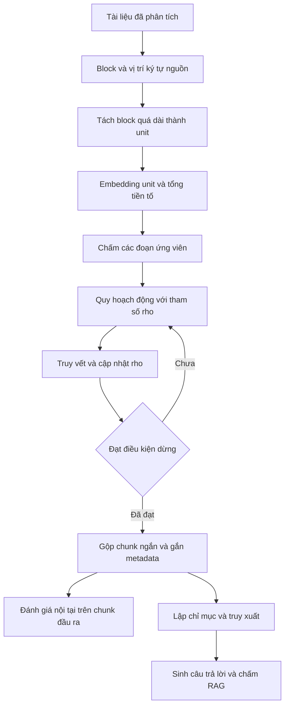

# Báo cáo tổng kết quá trình xây dựng SDP Chunking

**Nhóm nghiên cứu:** Nguyễn Tiến Đạt · Nguyễn Văn Phúc · Nguyễn Công Thành

**Tên phương pháp:** Structure-aware Dynamic Programming — SDP

**Công trình nghiên cứu:** *Document Chunking with Structure-Aware Dynamic Programming*

## 1 Tóm tắt nghiên cứu

SDP Chunking giải quyết bài toán lựa chọn ranh giới phân đoạn tài liệu cho hệ thống truy xuất tăng cường sinh câu trả lời, hay Retrieval-Augmented Generation (RAG). Phương pháp sử dụng cấu trúc do bộ phân tích tài liệu cung cấp, đánh giá các nhóm block liên tiếp bằng tín hiệu ngữ nghĩa và lựa chọn đồng thời chuỗi ranh giới bằng quy hoạch động. Mục tiêu là tạo ra các chunk vừa giữ được nội dung liên quan bên trong, vừa phù hợp với ngữ cảnh xung quanh và giới hạn độ dài của hệ thống.

Quá trình xây dựng bắt đầu từ việc nghiên cứu và tái lập nền tảng Adaptive Chunking, chuẩn hóa dữ liệu cùng bộ đo chất lượng, rồi phát triển bộ chia theo cấu trúc. Trên nền đó, nhóm bổ sung embedding, cơ chế tính điểm nhanh bằng tổng tiền tố, tối ưu điểm trung bình của toàn bộ phân đoạn và tích hợp vào pipeline RAG dùng chung. Đánh giá cuối cùng bao gồm phân bố kích thước chunk, chất lượng nội tại và chất lượng truy xuất cũng như trả lời.

Theo bản nghiên cứu final, trên 33 tài liệu CLAIR, cấu hình SDP mục tiêu 700 token đạt điểm trung bình năm thước đo nội tại là **94.65**, so với **91.07** của Adaptive Chunking đã công bố. Trong đánh giá RAG trên **438 câu hỏi**, với toàn bộ **129 tài liệu clair_ext** được lập chỉ mục, SDP đạt retrieval completeness **92.01** và correctness trên các câu đã trả lời **87.35**. Điểm trung bình của hai thước đo là **89.68**, so với **79.77** của Adaptive Chunking được tái lập trong nghiên cứu.

Các phần dưới trình bày cơ sở thiết kế, từng lớp triển khai trong repository và cách diễn giải kết quả. Bảng 2, Bảng 3 và Bảng 5 giữ nguyên nội dung cùng chú thích tiếng Anh của bản nghiên cứu.

## 2 Bài toán và động lực thiết kế

### 2.1 Ranh giới chunk quyết định bằng chứng mà mô hình nhận được

Một đoạn văn có thể nêu quy tắc chung, còn đoạn ngay sau mô tả ngoại lệ. Nếu hai đoạn bị tách và hệ thống chỉ truy xuất được quy tắc, mô hình có thể đưa ra câu trả lời trôi chảy nhưng thiếu điều kiện quan trọng. Vì vậy, chất lượng chunking liên quan trực tiếp đến khả năng cung cấp đủ bằng chứng cho câu trả lời.

Chia theo trang giữ được đơn vị trình bày nhưng ranh giới trang không nhất thiết là ranh giới nội dung. Chia theo kích thước giúp kiểm soát ngân sách token nhưng có thể tách một lập luận đang tiếp diễn. Chia theo ngữ nghĩa nhận biết sự thay đổi chủ đề, song độ tương đồng giữa các đoạn chưa đủ để bảo đảm rằng quy tắc, ngoại lệ và tham chiếu được giữ cùng nhau.

Nhóm đặt câu hỏi nghiên cứu ở cấp độ toàn tài liệu: **trong các cách nhóm những block liền kề thành chunk hợp lệ, chuỗi ranh giới nào đạt chất lượng trung bình tốt nhất?** Cách đặt bài toán này dẫn đến một không gian tìm kiếm có cấu trúc và có thể giải bằng quy hoạch động.

### 2.2 Nền tảng Adaptive Chunking

Adaptive Chunking tạo các phương án phân đoạn bằng những bộ chia ứng viên, đánh giá chúng bằng các chỉ số nội tại và chọn phương án cho từng tài liệu. Trong pipeline tái lập của repo, tập ứng viên gồm recursive với hai kích thước mục tiêu, chia theo trang đã hậu xử lý và LLM regex. Các baseline khác hỗ trợ so sánh với cách chia thông dụng.

Từ nền tảng này, nhóm kế thừa biểu diễn tài liệu, bộ đo chất lượng, cơ chế hậu xử lý và công cụ đánh giá RAG. SDP đưa quyết định tối ưu vào chính bước dựng phân đoạn: từng đoạn liên tiếp có thể trở thành ứng viên, sau đó thuật toán chọn tổ hợp các đoạn phủ toàn bộ tài liệu.

Các thành phần nền tảng nằm trong [src/adaptive_chunking](src/adaptive_chunking), đặc biệt là [paper/replicate.py](src/adaptive_chunking/paper/replicate.py), [metrics.py](src/adaptive_chunking/metrics.py) và [postprocessing.py](src/adaptive_chunking/postprocessing.py). Phần mở rộng SDP được tổ chức trong [research/structure_chunker](research/structure_chunker).

## 3 Quá trình xây dựng phương pháp

### 3.1 Thiết lập nền tảng tái lập và so sánh

Trước khi xây dựng bộ chia mới, nhóm cần một pipeline có thể theo dõi từ tài liệu nguồn đến kết quả đo. Repo tổ chức đầu ra thành các giai đoạn `raw`, `no_oversizing` và `small_merged`, tương ứng với chunk ban đầu, chunk sau xử lý quá dài và chunk sau gộp các mảnh ngắn. Việc giữ các giai đoạn riêng giúp xác định chính xác đầu vào của mỗi phép đánh giá.

[reproduction_runner.py](research/week2/reproduction_runner.py) bổ sung công cụ chia việc theo tài liệu, chạy các bước tái lập, hợp nhất artifact và kiểm tra cấu trúc dữ liệu. Các phiên bản mô hình dùng trong quá trình chấm được ghi nhận trong mã và cấu hình. Đây là nền tảng kỹ thuật để đối chiếu các phương pháp trên cùng cách biểu diễn và cùng định nghĩa thước đo.

### 3.2 Xây dựng bộ chia dựa trên block cấu trúc

Ở bước đầu, [struct_chunker.py](research/structure_chunker/struct_chunker.py) mô hình hóa việc nhóm các block liên tiếp thành một bài toán tối ưu. Hàm chi phí xét độ lệch khỏi kích thước mục tiêu, chunk quá ngắn, tiêu đề bị tách khỏi phần nội dung theo sau và các dấu hiệu tham chiếu ở đầu đoạn kế tiếp.

Ý nghĩa của bước này là chuyển đơn vị xử lý từ chuỗi ký tự tùy ý sang các block có vị trí trong tài liệu. Khi ranh giới ứng viên gắn với cấu trúc đã phân tích, đầu ra dễ truy vết hơn và có cơ sở để giữ nguyên đoạn văn, tiêu đề, danh sách hoặc bảng.

### 3.3 Chuẩn hóa lõi SDP theo cấu trúc

[sdp_chunker.py](research/structure_chunker/sdp_chunker.py) tách các trách nhiệm thành những thành phần rõ ràng:

- `Unit` lưu vị trí đầu, cuối, số token và đặc trưng cấu trúc của từng đơn vị.
- `build_units()` chuyển các block nguồn thành đơn vị hợp lệ, có xử lý riêng cho block quá dài.
- `boundary_score()` đánh giá việc đặt ranh giới trước một đơn vị.
- `dp_segment()` tìm phương án phân đoạn bằng quy hoạch động và lưu đường truy vết.
- `sdp_chunk()` dựng lại văn bản chunk từ các vị trí đã chọn.

Các tín hiệu cấu trúc bao gồm tiêu đề Markdown, đoạn mở đầu bằng chữ thường có khả năng tiếp nối đoạn trước, đại từ, danh sách, dấu hai chấm và các chú thích bố cục trang. Chúng được đưa vào hàm điểm dưới dạng thưởng hoặc phạt, với trọng số điều chỉnh qua `SDPConfig`.

Đây là các ưu tiên mềm. Chẳng hạn, phạt ranh giới trước một đoạn tiếp nối sẽ làm thuật toán hạn chế lựa chọn đó khi có phương án phù hợp hơn; nó không biến mọi dấu hiệu ngôn ngữ thành một quy tắc cấm tuyệt đối.

### 3.4 Bổ sung chấm điểm ngữ nghĩa

Trong [sdp_embed.py](research/structure_chunker/sdp_embed.py), nhóm xây dựng `EmbedScorer` để đánh giá sự gắn kết bên trong mỗi đoạn ứng viên và sự phù hợp của đoạn với ngữ cảnh. Mỗi unit chỉ cần được mã hóa một lần. Những đoạn ứng viên chồng lấn dùng lại embedding thông qua tổng tiền tố, giúp tránh mã hóa lại toàn bộ văn bản cho từng phương án cắt.

Bước này mở rộng khả năng ra quyết định: một ranh giới không chỉ được xét theo hình thức trình bày mà còn theo nội dung của nhóm block trước và sau nó. Cấu trúc giới hạn không gian tìm kiếm; ngữ nghĩa giúp phân biệt chất lượng giữa các cách nhóm hợp lệ.

### 3.5 Tối ưu điểm trung bình và khảo sát cấu hình

Khi số lượng chunk thay đổi giữa các phương án, tối đa hóa tổng điểm có thể ưu tiên một phương án chỉ vì nó tạo nhiều chunk có điểm dương. Nhóm sử dụng tối ưu phân thức theo Dinkelbach để tìm phương án có **điểm trung bình trên chunk** cao nhất.

Repo đồng thời có các công cụ khảo sát trọng số ngữ nghĩa, trọng số cấu trúc và tín hiệu tham chiếu trong [headroom/proxy_sweep.py](research/structure_chunker/headroom/proxy_sweep.py). `RCScorer` mở rộng điểm ngữ nghĩa bằng hình phạt tại ranh giới làm tách các cặp thực thể–đại từ đã phát hiện. [tune.py](research/structure_chunker/tune.py) cung cấp cơ chế chọn cấu hình theo các fold tài liệu, với việc chọn cấu hình diễn ra trên các fold huấn luyện trước khi lấy điểm ở fold giữ lại.

Những thành phần này thể hiện cách nhóm tổ chức quá trình khảo sát: giữ nguyên dữ liệu nguồn, thay đổi từng nhóm tín hiệu, lưu chunk của mỗi cấu hình và chấm lại đầu ra bằng bộ đo chính thức. Các kết quả định lượng cuối cùng được trình bày trong ba bảng ở phần 8.

### 3.6 Đưa SDP vào đánh giá RAG

Sau khi tạo chunk, nhóm ánh xạ từng chunk về tài liệu và khoảng ký tự nguồn, đưa vào định dạng dùng chung cho lập chỉ mục, truy xuất và chấm câu trả lời. [prepare_sdp_retrieval.py](research/structure_chunker/retrieval/prepare_sdp_retrieval.py) bổ sung các hệ thống SDP vào bộ đầu vào đánh giá và lưu metadata cùng mã băm của các tệp liên quan.

Đối với tập mở rộng, [prepare_ext.py](research/data_expansion/prepare_ext.py) chuẩn bị lựa chọn Adaptive theo từng tài liệu, các chunk SDP và hệ thống JSONL có cùng schema. Nhờ đó, việc so sánh downstream có thể tập trung vào ảnh hưởng của phân đoạn trong một giao thức truy xuất và sinh câu trả lời chung.

## 4 Dữ liệu và biểu diễn tài liệu

### 4.1 Hai phạm vi đánh giá

CLAIR được dùng cho phân bố kích thước và đánh giá nội tại trong Bảng 2 và Bảng 3. Tập này gồm 33 tài liệu, trong đó có 9 tài liệu kỹ thuật, 16 tài liệu pháp lý và 8 tài liệu khoa học xã hội, với tổng độ dài sau phân tích khoảng 1.18 triệu token.

Đánh giá downstream ở Bảng 5 sử dụng toàn bộ 129 tài liệu clair_ext. Bộ câu hỏi đã cố định gồm 438 câu gắn với 126 tài liệu. Cả ba tài liệu không có câu hỏi riêng vẫn được lập chỉ mục và có thể được truy xuất. Như vậy, không gian tìm kiếm của mỗi hệ thống là toàn bộ corpus chung.

Cả CLAIR và tập mở rộng đều tham gia vào quá trình phát triển phương pháp, như bản nghiên cứu đã nêu. Vì vậy, phạm vi kết luận của báo cáo gắn với những tập tài liệu và giao thức đánh giá này.

### 4.2 Biểu diễn thống nhất từ parser

Tài liệu sau phân tích có các trường chính:

| Trường | Vai trò trong pipeline |
| --- | --- |
| `full_text` | Toàn bộ nội dung theo thứ tự đọc |
| `split_points` | Các vị trí ký tự xác định ranh giới block |
| `pages` | Nội dung theo trang để truy vết và kiểm tra bằng chứng |
| `titles` | Tiêu đề, cấp tiêu đề và vị trí trong tài liệu |
| `document_name` | Tên tài liệu để nối các bước xử lý |

Biểu diễn CLAIR giữ cấu trúc được trích xuất bằng Azure AI Document Intelligence. Với dữ liệu mở rộng, [parse_docling.py](research/data_expansion/parse_docling.py) chuyển kết quả Docling về cùng schema, xử lý dấu trang cùng quá trình dựng văn bản và vị trí block. Mã xử lý bảng, tiêu đề, đầu trang và chân trang để các bước sau tiếp tục làm việc trên một hệ tọa độ ký tự thống nhất.

[build_set.py](research/data_expansion/build_set.py) áp dụng điều kiện đưa tài liệu vào tập dữ liệu, tạo định danh và lưu manifest cùng mã băm. Điều này giúp gắn kết câu hỏi, chunk, tài liệu nguồn và kết quả truy xuất mà không chỉ dựa vào tên tệp.

### 4.3 Chuẩn bị câu hỏi và bằng chứng

[gen_qa.py](research/data_expansion/gen_qa.py) tổ chức quy trình thành các bước xuất ngữ cảnh, sinh QA, kiểm tra trích dẫn, rà soát và đóng băng bộ câu hỏi. Các bản ghi QA chứa câu hỏi, câu trả lời tham chiếu, định danh tài liệu và bằng chứng với vị trí trong văn bản.

Kiểm tra bằng chứng giúp bảo đảm đoạn trích có thể được ánh xạ về nguồn. Sau khi đóng băng, bộ câu hỏi trở thành đầu vào chung của các hệ thống. Đây là điều kiện cần để diễn giải khác biệt downstream trên cùng một tập yêu cầu thông tin.

## 5 Thuật toán SDP

### 5.1 Từ block nguồn đến unit

Gọi các đơn vị theo thứ tự đọc là $b_1, b_2, \ldots, b_n$. Mỗi đơn vị có khoảng ký tự nguồn và số token. Nếu một block vượt 1,100 token, nó được chia đệ quy thành các phần nhỏ hơn trước bước tối ưu; các phần vẫn giữ vị trí tương ứng trong văn bản.

Một chunk ứng viên $(i,j)$ gồm các đơn vị từ $i+1$ đến $j$. Nó phải nằm trong giới hạn tìm kiếm 1,100 token. Các ranh giới ở đầu và cuối tài liệu là bắt buộc, bảo đảm phương án cuối cùng phủ toàn bộ tài liệu theo thứ tự.

Trong hiện thực, các unit còn mang dấu hiệu như `heading_level`, `starts_pronoun`, `starts_list`, `ends_colon`, `is_artifact` và `internal`. Những đặc trưng này giúp xác định chi phí ranh giới mà không phải phân tích lại văn bản ở mỗi bước DP.

### 5.2 Vector đại diện đoạn ứng viên

Gọi $e_k$ là embedding đã chuẩn hóa của unit $k$, và $t_k$ là độ dài token của unit đó. Vector đại diện của đoạn ứng viên được tính bằng tổng có trọng số rồi chuẩn hóa:

$$
c_{ij}=\operatorname{norm}\left(\sum_{k=i+1}^{j}t_ke_k\right).
$$

`EmbedScorer` duy trì tổng tiền tố của số token, embedding và embedding nhân trọng số token. Vì vậy, tổng trên một đoạn liên tiếp được lấy bằng hiệu của hai tổng tiền tố. Kết quả thành phần của từng cặp $(i,j)$ còn được lưu trong cache để dùng lại qua các vòng tối ưu.

### 5.3 Hai tín hiệu ngữ nghĩa dùng trong tìm kiếm

Độ gắn kết nội bộ xấp xỉ được tính bằng mức tương đồng trung bình giữa các unit và vector đại diện đoạn:

$$
ICC'(i,j)=\frac{1}{j-i}\sum_{k=i+1}^{j}e_k^{\mathsf T}c_{ij}.
$$

Độ phù hợp với ngữ cảnh xấp xỉ là mức tương đồng giữa vector đoạn và vector cửa sổ xung quanh:

$$
DCC'(i,j)=c_{ij}^{\mathsf T}c_{W_{ij}}.
$$

Cửa sổ có ngân sách danh nghĩa khoảng 3,000 token và bao gồm đoạn đang xét. Do các vector đã chuẩn hóa, tích vô hướng biểu diễn cosine similarity. Với chunk chỉ có một unit, quá trình tìm kiếm có cơ chế dùng giá trị cohesion chung thay vì xem phép so sánh một unit với chính nó là bằng chứng chất lượng hoàn hảo.

Điểm $s(i,j)$ kết hợp các tín hiệu ngữ nghĩa và, tùy cấu hình, các thành phần cấu trúc hoặc tham chiếu. Chunk dưới 100 token chịu hình phạt để hạn chế mảnh quá ngắn. Những thành phần này cùng tác động lên lựa chọn ranh giới, thay vì chỉ sửa đầu ra sau khi đã cắt.

### 5.4 Hàm mục tiêu trên toàn bộ phân đoạn

Một phương án $P$ là chuỗi các đoạn liên tiếp từ đầu đến cuối tài liệu. Gọi $K(P)$ là số chunk của phương án đó. Hàm mục tiêu là:

$$
P^*\in\arg\max_P\frac{\sum_{(i,j)\in P}s(i,j)}{K(P)}.
$$

Điểm trung bình đặt các phương án có số chunk khác nhau trên cùng cơ sở so sánh. Trong không gian ứng viên đã xác định, thuật toán xem xét tác động của từng ranh giới lên toàn bộ đường phân đoạn.

### 5.5 Quy hoạch động kết hợp Dinkelbach

Với một giá trị $\rho$, bài toán được chuyển thành tối đa hóa tổng $s(i,j)-\rho$. Đặt $D_\rho(0)=0$, các trạng thái chưa tới được có giá trị $-\infty$, và $I(j)$ là tập vị trí bắt đầu hợp lệ của đoạn kết thúc tại $j$:

$$
D_\rho(j)=\max_{i\in I(j)}\left[D_\rho(i)+s(i,j)-\rho\right].
$$

Quy trình giải gồm các bước:

1. Khởi tạo $\rho=0$.
2. Giải bài toán quy hoạch động cộng tính cho toàn bộ tài liệu.
3. Truy vết từ cuối về đầu để lấy phương án phân đoạn.
4. Cập nhật $\rho$ bằng điểm trung bình của phương án vừa tìm được.
5. Lặp đến khi thay đổi nhỏ hơn $10^{-6}$ hoặc đạt tối đa 12 vòng.

Phần hiện thực nằm ở `dinkelbach_segment()` trong [sdp_embed.py](research/structure_chunker/sdp_embed.py), sử dụng `dp_segment()` làm bộ giải cộng tính. Giới hạn độ dài giúp loại bỏ các đoạn quá lớn khi duyệt ngược vị trí bắt đầu. Tổng tiền tố và cache giúp tái sử dụng phần tính điểm giữa các vòng.

### 5.6 Hậu xử lý và bảo toàn văn bản

Sau khi truy vết, các ranh giới unit được chuyển về vị trí ký tự để cắt trực tiếp từ `full_text`. Chunk ngắn có thể được gộp với chunk lân cận nếu tổng độ dài không vượt 1,150 token. Các chunk sau bước này mới được dùng để lập chỉ mục và đánh giá.

Giới hạn 1,100 token trong tìm kiếm và ngưỡng 1,150 token khi gộp phục vụ hai bước khác nhau. Do đó, cần đọc phân bố độ dài đầu ra cùng với quy tắc hậu xử lý. Chỉ số SC vẫn chấm theo khoảng đóng từ 100 đến 1,100 token.

[run_sdp.py](research/structure_chunker/run_sdp.py) kiểm tra việc ghép các chunk thô có khôi phục đúng văn bản nguồn hay không và kiểm tra khoảng trống nội dung sau gộp. Hàm `records_for()` bổ sung trang, ngữ cảnh tiêu đề, thứ tự chunk và độ dài token cho đầu ra.

## 6 Kiến trúc triển khai và kiểm soát chất lượng

### 6.1 Luồng xử lý tổng thể

Luồng này tách hai loại tính toán: chấm nhanh phục vụ tìm kiếm ranh giới và chấm chính thức sau khi đã có chunk đầu ra. [score_full.py](research/structure_chunker/score_full.py) gọi lại bộ đo của package gốc, tải mô hình với revision được ghi rõ và lưu thông tin môi trường thực thi.

### 6.2 Artifact phục vụ truy vết

| Artifact | Nội dung và mục đích |
| --- | --- |
| `config.json` | Tham số chunker, thông tin mô hình và môi trường của lần chạy |
| `chunks/raw/chunks.parquet` | Chunk ngay sau bước phân đoạn |
| `chunks/small_merged/chunks.parquet` | Chunk sau gộp mảnh ngắn, dùng cho các bước tiếp theo |
| `cheap_metrics.parquet` | Các phép đo SC, BI, RC và thông tin chunk không cần bước embedding đầy đủ |
| `metrics/chunking_metrics.parquet` | Kết quả chấm bộ thước đo nội tại |
| `prepared/systems/*.jsonl` | Chunk theo schema chung cho lập chỉ mục và truy xuất |
| Manifest và mã băm | Gắn kết dữ liệu, cấu hình và các đầu vào của từng giai đoạn |

Với embedding, repo có cơ chế lưu unit embedding và nạp lại khi chạy các cấu hình. Đối với API, các bước sinh QA, tạo câu trả lời và chấm điểm có lưu phản hồi hoặc nhật ký để tiếp tục công việc và truy vết các yêu cầu đã thực hiện.

### 6.3 Các thuộc tính được mã hóa trong bộ kiểm thử

Bộ kiểm thử SDP trong repo thể hiện các yêu cầu kỹ thuật cốt lõi: khôi phục văn bản từ chunk, đặt ranh giới theo unit, ưu tiên tiêu đề trong trường hợp phù hợp, hạn chế cắt trước đoạn tiếp nối, xử lý chú thích trang, chia block quá dài và đáp ứng thay đổi kích thước mục tiêu. Các kiểm thử embedding sử dụng dữ liệu tổng hợp để kiểm tra điểm của unit giống nhau, ranh giới chuyển chủ đề và hành vi hội tụ của hàm mục tiêu.

Ở tầng đánh giá, repo có kiểm thử cho việc ánh xạ bằng chứng về đúng tài liệu, tránh tính lặp phần bằng chứng chồng lấn, chia fold theo tài liệu, phát hiện thay đổi QA và kiểm tra thứ hạng truy xuất. Những kiểm thử này mô tả các thuộc tính cần giữ khi phát triển pipeline; kết quả nghiên cứu được đánh giá riêng bằng các chỉ số và giao thức dưới đây.

Nguồn mã: [test_sdp_chunker.py](research/structure_chunker/test_sdp_chunker.py), [test_sdp_embed.py](research/structure_chunker/test_sdp_embed.py), [test_phase_g_runner.py](tests/test_phase_g_runner.py) và [test_phase_i_table5.py](tests/test_phase_i_table5.py).

## 7 Phương pháp đánh giá

### 7.1 Kích thước và thời gian phân đoạn

Phân bố độ dài được tính trên các chunk đầu ra, dùng tokenizer `o200k_base`. Các thống kê gồm trung bình, lớn nhất, nhỏ nhất, độ lệch chuẩn và số chunk. Theo định nghĩa trong bản nghiên cứu, thời gian phân đoạn bắt đầu từ văn bản đã phân tích và kết thúc khi có chunk cuối cùng, bao gồm các tín hiệu dùng để chọn ranh giới.

Đây là phép tổng hợp trên chunk. Nó khác với việc tính một tỷ lệ cho từng tài liệu rồi lấy trung bình giữa các tài liệu, như một số thước đo nội tại.

### 7.2 Năm thước đo chất lượng nội tại

| Ký hiệu | Tên thước đo | Nội dung đánh giá |
| --- | --- | --- |
| RC | References Completeness | Tỷ lệ các cặp thực thể–đại từ đủ điều kiện được giữ cùng nhau |
| ICC | Intrachunk Cohesion | Độ tương đồng giữa các block hợp lệ và toàn bộ chunk chứa chúng |
| DCC | Document Contextual Coherence | Độ tương đồng giữa chunk và cửa sổ ngữ cảnh chứa nó |
| BI | Block Integrity | Mức độ giữ nguyên các block do parser xác định |
| SC | Size Compliance | Tỷ lệ chunk có độ dài từ 100 đến 1,100 token |

RC bỏ qua tài liệu không có cặp tham chiếu đủ điều kiện; các liên kết trong văn bản tiếng Anh được cung cấp bởi Maverick. BI dùng dung sai vị trí năm ký tự. ICC không lấy các chunk có ít hơn hai block hợp lệ vào phép tính cohesion. DCC dùng cửa sổ các chunk lân cận với ngân sách danh nghĩa 3,000 token.

Đối với mỗi thước đo, kết quả được lấy trung bình trên các tài liệu có giá trị xác định. Điểm tổng hợp của Bảng 3 là trung bình không trọng số của năm điểm thành phần. Vì SC là trung bình tỷ lệ theo tài liệu, không thể lấy trực tiếp số chunk toàn corpus nhân với phần trăm SC để suy ra số chunk vi phạm.

**Điểm tìm kiếm và điểm đánh giá có vai trò khác nhau.** Trong tìm kiếm, $ICC'$ và $DCC'$ được xấp xỉ từ embedding unit. Trong đánh giá chính thức, ICC và DCC mã hóa lại văn bản chunk đã phát ra bằng Jina Embeddings v3. Vector tổng có trọng số của các block không mặc nhiên bằng embedding của văn bản ghép từ những block đó.

### 7.3 Giao thức truy xuất và sinh câu trả lời

Mỗi phương pháp tạo một chỉ mục riêng từ cùng 129 tài liệu. Cả hai hệ thống nhận cùng 438 câu hỏi. Giao thức của bản nghiên cứu final gồm:

1. Lấy 50 ứng viên đứng đầu từ BM25.
2. Lấy 50 ứng viên đứng đầu từ truy xuất dense bằng Qwen3-Embedding-4B.
3. Hợp nhất ứng viên, loại trùng và xếp hạng lại bằng Snowflake Arctic Embed L v2.0.
4. Dùng 10 chunk đứng đầu làm ngữ cảnh cho GPT-4.1.
5. Sinh câu trả lời với `temperature = 0`, `top_p = 1` và cho phép từ chối trả lời khi bằng chứng không đủ.

Trong repo, cấu hình truy xuất và metadata mô hình được tổ chức ở [phase_g_runner.py](research/week3/phase_g_runner.py). Giai đoạn sinh câu trả lời và chấm được tách thành [phase_i_table5.py](research/week3/phase_i_table5.py) và [phase_i_judge.py](research/week3/phase_i_judge.py).

### 7.4 Chấm bằng chứng và chất lượng câu trả lời

Một lượt đánh giá GPT-4.1 riêng chấm retrieval completeness dựa trên khả năng ngữ cảnh hỗ trợ câu trả lời tham chiếu. Ba mức hỗ trợ không đủ, một phần và đầy đủ tương ứng với 0, 50 và 100 điểm. Chỉ số này được tính trên toàn bộ câu hỏi.

Correctness được chấm bằng G-Eval trong DeepEval, dựa trên mức phù hợp về sự kiện giữa câu trả lời sinh ra và câu trả lời tham chiếu. Gọi $N=438$, $A$ là số câu hệ thống đã trả lời, $R$ là retrieval completeness trung bình và $C$ là correctness trung bình trên các câu đã trả lời. Điểm tổng hợp là:

$$
M=\frac{R+C}{2}.
$$

Độ bao phủ trả lời và correctness trên toàn bộ câu hỏi, khi gán điểm từ chối bằng 0, lần lượt là:

$$
\operatorname{Coverage}=\frac{A}{N}\times100\%,
\qquad
C_0=\frac{A}{N}C.
$$

Ba khái niệm cần được đọc cùng nhau: chất lượng trên những câu hệ thống quyết định trả lời, mức sẵn sàng trả lời và chất lượng trên toàn bộ tập câu hỏi. Các phép tính tổng hợp dùng điểm chưa làm tròn; việc tính lại từ các số đã hiển thị có thể khác ở chữ số cuối.

## 8 Kết quả cuối cùng

### 8.1 Bảng 2 về kích thước chunk và thời gian phân đoạn

| Chunking method | Mean | Max | Min | Std. dev. | Chunks | Time (s) |
| --- | --- | --- | --- | --- | --- | --- |
| SDP | 700 | 1,110 | 95 | 245 | ≈1,687 | 200.13 |
| Adaptive Chunking(published) | 724 | 1,146 | 86 | 247 | 1,631 | 210.66 |

Table 2. Chunk lengths (o200k_base tokens) and total segmentation time (seconds) for 33 CLAIR documents. Adaptive Chunking values are from de Moura Júnior et al. (2026, Table 2), who measured runtime in their own setup.

SDP tạo khoảng 1,687 chunk với độ dài trung bình 700 token, độ lệch chuẩn 245 token và phạm vi 95–1,110 token. Trung bình quan sát được phù hợp với cấu hình mục tiêu 700 token được mô tả trong bản nghiên cứu. Phân bố của Adaptive Chunking đã công bố có trung bình 724 token và độ lệch chuẩn 247 token.

Hai mức thời gian 200.13 và 210.66 giây phản ánh các thiết lập được báo cáo tương ứng. Bảng này mô tả chi phí phân đoạn; để kết luận về tốc độ tương đối cần điều kiện phần cứng, cache và ranh giới đo thời gian tương ứng. Vì vậy, kết quả được diễn giải cùng điều kiện đo nêu trong chú thích.

### 8.2 Bảng 3 về chất lượng nội tại

| Chunking method | RC | ICC | DCC | BI | SC | Mean |
| --- | --- | --- | --- | --- | --- | --- |
| LLM regex (GPT-5)* | 98.0 ± 2.9 | 70.9 ± 5.1 | 82.4 ± 5.5 | 98.1 ± 2.5 | 99.6 ± 1.3 | 89.80 |
| Recursive (1,100)* | 99.0 ± 1.8 | 66.6 ± 3.8 | 89.7 ± 2.5 | 98.1 ± 1.9 | 100.0 ± 0.1 | 90.68 |
| Recursive (600)* | 97.2 ± 2.9 | 69.6 ± 4.1 | 84.7 ± 3.1 | 94.8 ± 3.6 | 100.0 ± 0.0 | 89.24 |
| Page, processed* | 97.2 ± 3.5 | 69.2 ± 3.6 | 86.4 ± 4.6 | 99.9 ± 0.3 | 99.9 ± 0.4 | 90.52 |
| LC recursive (1,100)† | 98.4 ± 3.1 | 64.7 ± 3.4 | 86.8 ± 2.8 | 98.6 ± 1.4 | 93.3 ± 7.2 | 88.37 |
| LC recursive (default)† | 96.1 ± 4.3 | 65.6 ± 3.6 | 88.8 ± 2.4 | 95.0 ± 2.8 | 97.7 ± 6.3 | 88.62 |
| Page, raw† | 97.1 ± 3.5 | 69.3 ± 3.4 | 86.1 ± 5.0 | 100.0 ± 0.0 | 92.7 ± 9.7 | 89.03 |
| Semantic† | 97.5 ± 3.1 | 69.3 ± 4.1 | 76.3 ± 7.3 | 91.3 ± 4.0 | 48.1 ± 17.6 | 76.49 |
| Sentence† | 86.3 ± 11.1 | 78.4 ± 2.7 | 72.5 ± 5.8 | 61.9 ± 10.3 | 67.2 ± 23.1 | 73.26 |
| Adaptive Chunking | 99.0 ± 1.5 | 68.2 ± 4.7 | 88.8 ± 3.5 | 99.4 ± 1.2 | 99.9 ± 0.3 | 91.07 |
| SDP | 99.80 ± 0.58 | 84.15 ± 3.93 | 89.40 ± 2.66 | 99.94 ± 0.21 | 99.96 ± 0.18 | 94.65 |

Table 3. Intrinsic chunk quality on 33 CLAIR documents (0–100 scale). The final column gives the unweighted mean of the five metrics. In the SDP row, values following ± are illustrative standard deviations. For all other methods, de Moura Júnior et al. (2026, Table 3) report means and between-document standard deviations. An asterisk (*) identifies candidates for the adaptive selector. A dagger (†) identifies baselines without post-processing. LC denotes LangChain.

Điểm trung bình năm thước đo của SDP là 94.65, cao hơn 3.58 điểm so với mức 91.07 của Adaptive Chunking đã công bố. Khác biệt lớn nhất nằm ở ICC: 84.15 so với 68.2, tương ứng 15.95 điểm. Với trọng số bằng nhau, phần chênh lệch ICC đóng góp khoảng 3.19 điểm vào khoảng cách điểm tổng hợp.

DCC của hai phương pháp lần lượt là 89.40 và 88.8. RC, BI và SC của SDP đều ở mức cao trong bảng. Mẫu kết quả này cho thấy đóng góp nổi bật của SDP trong đánh giá nội tại nằm ở sự gắn kết bên trong chunk, đồng thời giữ được mức bảo toàn cấu trúc và tuân thủ kích thước cao.

Các ký hiệu `*` và `†` cần được đọc theo chú thích gốc: chúng phân biệt tập ứng viên của adaptive selector và baseline không hậu xử lý. Những dòng này đặt SDP trong bối cảnh các chiến lược chia khác nhau. Các giá trị sau dấu `±` được giữ nguyên theo ý nghĩa mà chú thích nguồn quy định, không được dùng làm khoảng tin cậy cho chênh lệch giữa các phương pháp.

### 8.3 Bảng 5 về kết quả RAG trên 438 câu hỏi

| Metric | SDP(438 questions) | Adaptive Chunking(438 questions) |
| --- | --- | --- |
| Retrieval completeness | 92.01 | 81.74 |
| Correctness on answered questions | 87.35 | 77.81 |
| Mean of the two metrics | 89.68 | 79.77 |
| Correctness on all 438 (abstention = 0) | 76.78 | 67.69 |
| Answer coverage (%) | 87.90 | 86.99 |
| Answered questions | 385 | 381 |
| Abstentions | 53 | 57 |
| Total questions | 438 | 438 |

Table 5. RAG results on 438 questions against all 129 clair_ext documents. Adaptive Chunking was reproduced in this study. The four graded scores use a 0–100 scale. The two-metric mean is (R + C)/2. Answer coverage is the percentage of questions answered (A/438 × 100).

Trong so sánh trên cùng corpus và bộ câu hỏi, SDP đạt retrieval completeness 92.01, cao hơn 10.27 điểm so với 81.74 của Adaptive Chunking tái lập. Điều này phản ánh mức hỗ trợ câu trả lời tham chiếu của ngữ cảnh truy xuất theo bộ chấm đã quy định.

Correctness trên các câu đã trả lời đạt 87.35 với SDP và 77.81 với Adaptive Chunking, chênh 9.54 điểm. Tuy nhiên, hai giá trị này là trung bình trên tập câu mà từng hệ thống đã trả lời. SDP trả lời 385 câu, còn Adaptive Chunking trả lời 381 câu; vì vậy, chúng cần được đọc cùng coverage và correctness trên toàn bộ câu hỏi.

Khi gán 0 điểm cho các trường hợp từ chối, SDP đạt 76.78 và Adaptive Chunking đạt 67.69, chênh 9.09 điểm. Coverage tương ứng là 87.90% và 86.99%. SDP vừa trả lời thêm bốn câu, vừa có điểm chất lượng toàn bộ tập cao hơn trong phép đánh giá này.

Điểm trung bình retrieval completeness và correctness có điều kiện là 89.68 đối với SDP, so với 79.77 của Adaptive Chunking, chênh 9.91 điểm. Đây là chênh lệch mô tả trên giao thức chung của nghiên cứu.

### 8.4 Ý nghĩa khi đọc ba bảng cùng nhau

Bảng 2 cho biết hình dạng đầu ra và thời gian tạo chunk. Bảng 3 mô tả chất lượng nội tại của phân đoạn. Bảng 5 kiểm tra hiệu quả của đầu ra đó khi đi qua truy xuất, sinh câu trả lời và chấm chất lượng. Ba lớp đánh giá giúp xem xét phương pháp từ tổ chức văn bản đến tác vụ sử dụng bằng chứng.

Các kết quả nội tại thuộc CLAIR, trong khi đánh giá RAG thuộc clair_ext. Bảng 2 và Bảng 3 tham chiếu các kết quả Adaptive Chunking đã công bố; Bảng 5 dùng bản Adaptive Chunking được tái lập trong nghiên cứu. Cần giữ sự phân biệt này khi kết nối các kết luận.

ICC cao hơn và retrieval completeness cao hơn phù hợp với định hướng thiết kế của SDP, nhưng chưa tự xác lập một quan hệ nhân quả giữa hai đại lượng. Để xác định một ranh giới cụ thể đã cải thiện câu trả lời như thế nào, cần lần theo bằng chứng từ khoảng văn bản nguồn, qua chunk chứa nó, đến ngữ cảnh được trả về cho từng câu hỏi.

## 9 Đóng góp của quá trình xây dựng SDP

Đóng góp thuật toán là mô hình hóa việc chọn ranh giới thành tối ưu một phân hoạch có thứ tự trên các unit cấu trúc. Quy hoạch động giải quyết đồng thời chuỗi quyết định, còn mục tiêu điểm trung bình xử lý việc số chunk có thể khác nhau giữa các phương án.

Đóng góp triển khai nằm ở việc kết hợp các tín hiệu cấu trúc với embedding unit, dùng tổng tiền tố và cache để phục vụ tìm kiếm, rồi tái sử dụng bộ đo chính thức để đánh giá chunk đầu ra. Cách tổ chức này tạo một đường kiểm tra từ tín hiệu dùng để ra quyết định đến kết quả đo trên sản phẩm cuối.

Đóng góp thực nghiệm là đánh giá phương pháp ở cả ba tầng: kích thước và thời gian, chất lượng nội tại, và hiệu quả RAG. Việc lập chỉ mục cùng corpus, dùng cùng câu hỏi và báo cáo cả abstention giúp diễn giải chất lượng câu trả lời trong bối cảnh mức độ bao phủ thực tế của từng hệ thống.

Về tổ chức nghiên cứu, repo phân tách package nền tảng, mã mở rộng thuật toán, công cụ dữ liệu và pipeline đánh giá. Artifact theo giai đoạn, cấu hình, định danh nguồn và bộ kiểm thử tạo điều kiện để tiếp tục nghiên cứu từng thành phần mà vẫn truy vết được ảnh hưởng của thay đổi.

## 10 Phạm vi kết luận và hướng phát triển

Kết quả cho thấy SDP có lợi thế trong đánh giá đã thực hiện, đặc biệt ở cohesion nội tại và completeness của bằng chứng truy xuất. Khả năng khái quát sang các họ tài liệu có bố cục hoặc cách lập luận khác cần được đánh giá thêm, vì cả CLAIR và clair_ext đều đã tham gia vào quá trình phát triển phương pháp.

Cùng họ embedding được dùng cho tín hiệu tìm kiếm ranh giới và cho ICC, DCC chính thức. Điều này khiến điểm nội tại phản ánh một phần cách biểu diễn của encoder. Các tín hiệu tham chiếu cũng phụ thuộc vào cặp thực thể–đại từ được phát hiện và phạm vi ngôn ngữ đủ điều kiện.

Chênh lệch ở Bảng 5 là kết quả mô tả. Việc ước lượng độ bất định cần điểm theo cặp ở cấp câu hỏi và cách phân tích tính đến nhiều câu hỏi cùng xuất phát từ một tài liệu. Correctness trên các câu đã trả lời cũng cần tiếp tục được trình bày cùng coverage và correctness toàn bộ tập.

Các hướng phát triển tiếp theo xuất phát trực tiếp từ thiết kế hiện tại: đánh giá trên họ tài liệu mới; dùng encoder độc lập để khảo sát mức phụ thuộc biểu diễn; phân tích trường hợp quy tắc–ngoại lệ và tham chiếu bị tách; và kiểm tra đường đi của bằng chứng từ nguồn đến câu trả lời. Cấu trúc metadata và các công cụ đánh giá trong repo tạo nền tảng cho những phân tích này.

## 11 Kết luận

Quá trình xây dựng SDP chuyển từ việc sử dụng cấu trúc tài liệu để tạo ranh giới hợp lệ sang việc đánh giá ngữ nghĩa từng đoạn ứng viên và tối ưu đồng thời toàn bộ phân đoạn. Lõi thuật toán kết hợp embedding unit, tổng tiền tố, quy hoạch động và cập nhật Dinkelbach; pipeline bao quanh bảo toàn vị trí nguồn, xử lý chunk ngắn và đánh giá trên đầu ra cuối cùng.

Trên CLAIR, SDP đạt điểm nội tại tổng hợp 94.65. Trong đánh giá chung 438 câu hỏi trên clair_ext, SDP đạt retrieval completeness 92.01, correctness có điều kiện 87.35 và correctness toàn bộ tập 76.78. Các kết quả này cho thấy việc thiết kế ranh giới theo cấu trúc kết hợp ngữ nghĩa là một hướng cải thiện có cơ sở cho quá trình cung cấp bằng chứng trong RAG, trong phạm vi dữ liệu và giao thức đã nghiên cứu.

## 12 Nguồn tài liệu và đối chiếu mã nguồn

Nguồn nghiên cứu chính là **Nguyễn Tiến Đạt, Nguyễn Văn Phúc và Nguyễn Công Thành, *Document Chunking with Structure-Aware Dynamic Programming***, bản final `SDP_Chunking_Paper_438QA_EN_links.docx`. Bảng 2, Bảng 3 và Bảng 5 cùng các số liệu kết quả trong báo cáo được lấy từ tài liệu này.

Các tài liệu nền tảng được bản nghiên cứu sử dụng gồm công trình Adaptive Chunking của de Moura Júnior, Lelong và Blangero; phương pháp tối ưu phân thức của Dinkelbach; và G-Eval của Liu cùng cộng sự. Phần đối chiếu triển khai trong báo cáo dựa trên các tệp mã nguồn sau:

| Nội dung | Mã nguồn đối chiếu |
| --- | --- |
| Pipeline và baseline nền tảng | [paper/replicate.py](src/adaptive_chunking/paper/replicate.py), [reproduction_runner.py](research/week2/reproduction_runner.py) |
| Bộ chia cấu trúc ban đầu | [struct_chunker.py](research/structure_chunker/struct_chunker.py) |
| Unit, điểm ranh giới và quy hoạch động | [sdp_chunker.py](research/structure_chunker/sdp_chunker.py) |
| Embedding proxy và Dinkelbach | [sdp_embed.py](research/structure_chunker/sdp_embed.py) |
| Chạy chunker và lưu đầu ra | [run_sdp.py](research/structure_chunker/run_sdp.py) |
| Tín hiệu tham chiếu và khảo sát cấu hình | [proxy_sweep.py](research/structure_chunker/headroom/proxy_sweep.py), [tune.py](research/structure_chunker/tune.py) |
| Bộ đo và bước chấm đầy đủ | [metrics.py](src/adaptive_chunking/metrics.py), [score_full.py](research/structure_chunker/score_full.py) |
| Hậu xử lý và metadata | [postprocessing.py](src/adaptive_chunking/postprocessing.py) |
| Chuẩn bị dữ liệu mở rộng | [parse_docling.py](research/data_expansion/parse_docling.py), [build_set.py](research/data_expansion/build_set.py) |
| QA và đóng băng bằng chứng | [gen_qa.py](research/data_expansion/gen_qa.py) |
| Đưa chunk vào định dạng đánh giá | [prepare_sdp_retrieval.py](research/structure_chunker/retrieval/prepare_sdp_retrieval.py), [prepare_ext.py](research/data_expansion/prepare_ext.py) |
| Truy xuất, sinh câu trả lời và chấm | [phase_g_runner.py](research/week3/phase_g_runner.py), [phase_i_table5.py](research/week3/phase_i_table5.py), [phase_i_judge.py](research/week3/phase_i_judge.py) |

