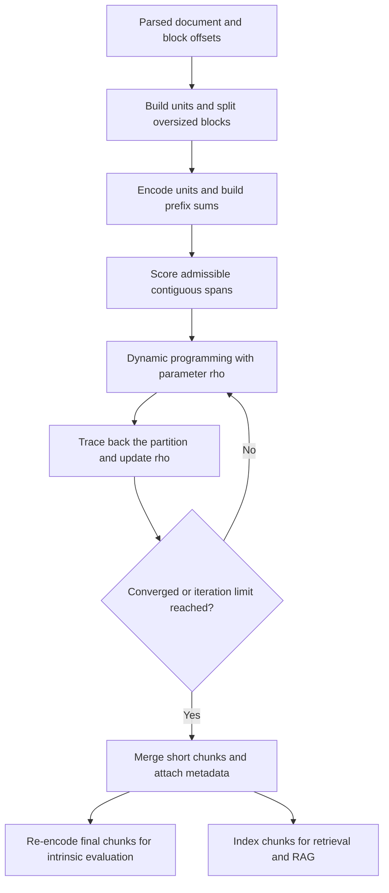

<div align="center">

# SDP Chunking

**Document Chunking with Structure-Aware Dynamic Programming**

Jointly selecting document boundaries for evidence retrieval and RAG

[](pyproject.toml)
[](LICENSE)

**Nguyễn Tiến Đạt · Nguyễn Văn Phúc · Nguyễn Công Thành**

[Method](#how-sdp-works) · [Results](#research-results) · [Quick start](#quick-start) · [Repository guide](#repository-guide) · [Citation](#citation)

</div>

SDP selects chunk boundaries jointly over the structural blocks of a document. It combines semantic cohesion, agreement with surrounding context, and configurable boundary signals, then uses dynamic programming to maximize the mean score of the resulting partition.

This repository contains the group's SDP research implementation, data preparation tools, and evaluation pipelines. It builds on [Adaptive Chunking](https://github.com/ekimetrics/adaptive-chunking) by Paulo Roberto de Moura Júnior, Jean Lelong, and Annabelle Blangero. The upstream framework supplies the baseline chunkers, intrinsic metrics, and supporting RAG components.

## Why document boundaries matter

A retrieved passage can state a rule while leaving its exception in the next chunk. Even a relevant passage may therefore provide incomplete evidence for an answer.

SDP treats segmentation as a document-wide decision. Parser blocks define the units that can be grouped together; semantic and structural signals score the possible groups. Dynamic programming selects a sequence of contiguous spans that covers the document in reading order.

The main components are:

- **Structure-aware units:** preserve source offsets and use parser boundaries, with recursive splitting for oversized blocks.
- **Reusable semantic scoring:** encode each unit once and use prefix sums to score overlapping candidate spans.
- **Mean-score optimization:** combine dynamic programming with Dinkelbach updates to compare partitions with different numbers of chunks.
- **Traceable outputs:** retain document, page, title, and chunk metadata for evaluation and retrieval.
- **Evaluation at three levels:** chunk lengths and segmentation time, intrinsic chunk quality, and downstream evidence retrieval and answer quality.

## How SDP works



### Candidate spans and semantic scores

Each unit has source character offsets and a token count. A candidate chunk groups consecutive units under a 1,100-token search ceiling. Its vector is the normalized, token-weighted sum of the unit embeddings:

$$
c_{ij}=\operatorname{norm}\left(\sum_{k=i+1}^{j}t_ke_k\right).
$$

The search uses two semantic proxies: agreement between the units and their candidate chunk, and agreement between the candidate and a surrounding window of roughly 3,000 tokens. Configurable terms can reward heading boundaries or penalize cuts at continuations, layout artifacts, or detected reference links. Short spans receive a penalty.

### Optimizing a complete partition

For a partition $P$ containing $K(P)$ chunks, SDP optimizes:

$$
P^*\in\arg\max_P\frac{1}{K(P)}\sum_{(i,j)\in P}s(i,j).
$$

For each value of $\rho$, the dynamic program solves:

$$
D_\rho(j)=\max_{i\in I(j)}\left[D_\rho(i)+s(i,j)-\rho\right].
$$

After traceback, $\rho$ is updated to the selected partition's mean score. The procedure stops when the change is below $10^{-6}$ or after 12 iterations. Short output chunks may then merge with a neighbor under a 1,150-token cap.

The search scores are approximations built from unit embeddings. Official ICC and DCC evaluation re-encodes the emitted chunk text with Jina Embeddings v3. See [sdp_chunker.py](research/structure_chunker/sdp_chunker.py), [sdp_embed.py](research/structure_chunker/sdp_embed.py), and [score_full.py](research/structure_chunker/score_full.py).

## Research results

The following tables reproduce the results and captions from the group's final manuscript, *Document Chunking with Structure-Aware Dynamic Programming*. A detailed account of the method and development process is available in the [final research report in Vietnamese](BAO_CAO_FINAL_SDP_CHUNKING.md).

**Evaluation scope:** Tables 2 and 3 describe the 700-token SDP configuration on 33 CLAIR documents and use published Adaptive Chunking reference values. Table 5 compares SDP with our reproduction of Adaptive Chunking on the same 438 questions, with all 129 clair_ext documents indexed. The questions are associated with 126 documents; the other three documents remain eligible for retrieval.

### RAG evaluation

| Metric | SDP(438 questions) | Adaptive Chunking(438 questions) |
| --- | --- | --- |
| Retrieval completeness | 92.01 | 81.74 |
| Correctness on answered questions | 87.35 | 77.81 |
| Mean of the two metrics | 89.68 | 79.77 |
| Correctness on all 438 (abstention = 0) | 76.78 | 67.69 |
| Answer coverage (%) | 87.90 | 86.99 |
| Answered questions | 385 | 381 |
| Abstentions | 53 | 57 |
| Total questions | 438 | 438 |

Table 5. RAG results on 438 questions against all 129 clair_ext documents. Adaptive Chunking was reproduced in this study. The four graded scores use a 0–100 scale. The two-metric mean is (R + C)/2. Answer coverage is the percentage of questions answered (A/438 × 100).

SDP's retrieval completeness is **10.27 points higher** in this evaluation. Its two-metric mean is **9.91 points higher**, and its correctness across all questions, including abstentions scored as zero, is **9.09 points higher**.

Correctness on answered questions is conditional on each system's answered subset. Read it alongside answer coverage and all-question correctness. These differences are descriptive; uncertainty estimation requires paired scores with document-level grouping.

<details>
<summary><strong>Table 2 — Chunk lengths and segmentation time</strong></summary>

| Chunking method | Mean | Max | Min | Std. dev. | Chunks | Time (s) |
| --- | --- | --- | --- | --- | --- | --- |
| SDP | 700 | 1,110 | 95 | 245 | ≈1,687 | 200.13 |
| Adaptive Chunking(published) | 724 | 1,146 | 86 | 247 | 1,631 | 210.66 |

Table 2. Chunk lengths (o200k_base tokens) and total segmentation time (seconds) for 33 CLAIR documents. Adaptive Chunking values are from de Moura Júnior et al. (2026, Table 2), who measured runtime in their own setup.

The reported times come from the respective experimental setups. A speed comparison requires matched hardware, cache conditions, and timing boundaries.

</details>

<details>
<summary><strong>Table 3 — Intrinsic chunk quality</strong></summary>

| Chunking method | RC | ICC | DCC | BI | SC | Mean |
| --- | --- | --- | --- | --- | --- | --- |
| LLM regex (GPT-5)* | 98.0 ± 2.9 | 70.9 ± 5.1 | 82.4 ± 5.5 | 98.1 ± 2.5 | 99.6 ± 1.3 | 89.80 |
| Recursive (1,100)* | 99.0 ± 1.8 | 66.6 ± 3.8 | 89.7 ± 2.5 | 98.1 ± 1.9 | 100.0 ± 0.1 | 90.68 |
| Recursive (600)* | 97.2 ± 2.9 | 69.6 ± 4.1 | 84.7 ± 3.1 | 94.8 ± 3.6 | 100.0 ± 0.0 | 89.24 |
| Page, processed* | 97.2 ± 3.5 | 69.2 ± 3.6 | 86.4 ± 4.6 | 99.9 ± 0.3 | 99.9 ± 0.4 | 90.52 |
| LC recursive (1,100)† | 98.4 ± 3.1 | 64.7 ± 3.4 | 86.8 ± 2.8 | 98.6 ± 1.4 | 93.3 ± 7.2 | 88.37 |
| LC recursive (default)† | 96.1 ± 4.3 | 65.6 ± 3.6 | 88.8 ± 2.4 | 95.0 ± 2.8 | 97.7 ± 6.3 | 88.62 |
| Page, raw† | 97.1 ± 3.5 | 69.3 ± 3.4 | 86.1 ± 5.0 | 100.0 ± 0.0 | 92.7 ± 9.7 | 89.03 |
| Semantic† | 97.5 ± 3.1 | 69.3 ± 4.1 | 76.3 ± 7.3 | 91.3 ± 4.0 | 48.1 ± 17.6 | 76.49 |
| Sentence† | 86.3 ± 11.1 | 78.4 ± 2.7 | 72.5 ± 5.8 | 61.9 ± 10.3 | 67.2 ± 23.1 | 73.26 |
| Adaptive Chunking | 99.0 ± 1.5 | 68.2 ± 4.7 | 88.8 ± 3.5 | 99.4 ± 1.2 | 99.9 ± 0.3 | 91.07 |
| SDP | 99.80 ± 0.58 | 84.15 ± 3.93 | 89.40 ± 2.66 | 99.94 ± 0.21 | 99.96 ± 0.18 | 94.65 |

Table 3. Intrinsic chunk quality on 33 CLAIR documents (0–100 scale). The final column gives the unweighted mean of the five metrics. In the SDP row, values following ± are illustrative standard deviations. For all other methods, de Moura Júnior et al. (2026, Table 3) report means and between-document standard deviations. An asterisk (*) identifies candidates for the adaptive selector. A dagger (†) identifies baselines without post-processing. LC denotes LangChain.

SDP's five-metric mean is **3.58 points above** the published Adaptive Chunking reference. The largest difference is in intrachunk cohesion. The caption retains the manuscript's distinction between illustrative and measured standard deviations.

</details>

### Evaluation protocol

| Component | Protocol in the final manuscript |
| --- | --- |
| Intrinsic corpus | 33 CLAIR documents |
| Token counting | `o200k_base` |
| Intrinsic encoder | Jina Embeddings v3 |
| RAG corpus | All 129 clair_ext documents |
| Frozen evaluation set | 438 questions |
| Candidate retrieval | Top 50 BM25 + top 50 Qwen3-Embedding-4B results, deduplicated |
| Reranking | Snowflake Arctic Embed L v2.0 |
| Generator context | Top 10 chunks |
| Answer generation | GPT-4.1, temperature 0, top-p 1; abstention allowed |
| Retrieval completeness | Separate GPT-4.1 judgment: 0, 50, or 100 |
| Answer correctness | G-Eval in DeepEval, evaluated against the reference answer |

The intrinsic metrics are **References Completeness (RC)**, **Intrachunk Cohesion (ICC)**, **Document Contextual Coherence (DCC)**, **Block Integrity (BI)**, and **Size Compliance (SC)**. Each metric is averaged across documents with a defined value; the final table mean gives the five component means equal weight.

Both CLAIR and clair_ext informed method development. Generalization to new document families remains to be evaluated. The shared encoder family used for search and intrinsic evaluation also matters when interpreting cohesion gains.

## Quick start

### Set up the environment

Use Python 3.11 or later. Clone the group's repository and create an isolated environment:

```bash
git clone https://github.com/datnt-numenor/Adaptive-chunking-enhancements.git
cd Adaptive-chunking-enhancements
python -m venv .venv
```

Activate it using the command for your shell:

```powershell
# Windows PowerShell
.\.venv\Scripts\Activate.ps1
```

```bash
# Linux or macOS
source .venv/bin/activate
```

Install the core package, test tools, and a Parquet engine:

```bash
python -m pip install -e ".[test]" pyarrow
```

The package retains the import name `adaptive_chunking`. SDP entry points live under `research/structure_chunker/` and are run from the repository root.

### Run a structure-only smoke test

The included `data/clair/` directory contains parsed documents and precomputed reference mentions. Start with the three smallest documents:

```bash
python -X utf8 research/structure_chunker/run_sdp.py --data-dir data/clair --out runs/sdp/readme_structure_smoke --method sdp_a --smallest 3
```

This runs the structure-only variant, merges short chunks, and computes SC, BI, and RC. It does not require embedding inference or paid API calls. Choose a fresh output directory for each configuration.

### Run the embedding-based variant

The embedding path loads Jina Embeddings v3 locally through SentenceTransformers. Prepare a compatible PyTorch/CUDA environment and the model's runtime dependencies. Model and remote-code revisions are pinned in [score_full.py](research/structure_chunker/score_full.py); the [recorded environment snapshot](research/structure_chunker/requirements-freeze-2026-11-12.txt) provides version details for reference.

```bash
python -X utf8 research/structure_chunker/run_sdp.py --data-dir data/clair --out runs/sdp/readme_embedding_smoke --method sdp_b --embed --embed-model jina --device cuda:0 --smallest 3
```

Remove `--smallest 3` and use a new output directory to process the full CLAIR corpus. Unit embeddings are cached under `runs/sdp/_unit_emb/` for reuse with the same inputs and configuration.

These examples exercise the implementation with its default settings. Reproducing a reported experiment additionally requires its exact configuration, dataset, model revisions, and evaluation artifacts.

### Score the emitted chunks

To compute all five intrinsic metrics on the embedding smoke-test output:

```bash
python -X utf8 research/structure_chunker/score_full.py run runs/sdp/readme_embedding_smoke --data-dir data/clair --device cuda:0 --batch-size 8
```

The run and scoring stages produce:

```text
<output-directory>/
├── config.json
├── chunks/
│   ├── raw/chunks.parquet
│   └── small_merged/chunks.parquet
├── cheap_metrics.parquet
└── metrics/
    ├── chunking_metrics.parquet
    ├── metrics_performance.parquet
    └── environment.json
```

`raw` stores the segmentation before short-chunk merging; `small_merged` is the stage used for subsequent scoring and indexing. Chunk records include the document name, method, chunk index, text, pages, title context, and token count.

### Run the SDP tests

```bash
python -m pytest research/structure_chunker/test_sdp_chunker.py research/structure_chunker/test_sdp_embed.py -q
```

These tests cover text reconstruction, structural boundaries, oversized blocks, size controls, semantic topic changes, and the mean-score objective. The package test suite is available through `python -m pytest tests` and may require the optional dependencies used by individual modules.

## Data and downstream evaluation

Parsed inputs use this shared schema:

```text
<data-directory>/
├── adi_parsed/*.json   # document_name, full_text, pages, split_points, titles
└── mentions/*.parquet # precomputed entity–pronoun pairs for RC
```

The extended-corpus tools are in [research/data_expansion](research/data_expansion). They cover document acquisition, Docling parsing, corpus manifests, QA validation, and freezing questions with source evidence spans.

Downstream evaluation is organized into separate stages:

| Stage | Entry point |
| --- | --- |
| Parse extended documents into the shared schema | [parse_docling.py](research/data_expansion/parse_docling.py) |
| Build the document set and identifiers | [build_set.py](research/data_expansion/build_set.py) |
| Generate, validate, review, and freeze QA | [gen_qa.py](research/data_expansion/gen_qa.py) |
| Prepare extended-corpus systems | [prepare_ext.py](research/data_expansion/prepare_ext.py) |
| Register SDP systems with the evaluation harness | [prepare_sdp_retrieval.py](research/structure_chunker/retrieval/prepare_sdp_retrieval.py) |
| Build indexes, retrieve, and evaluate retrieval | [phase_g_runner.py](research/week3/phase_g_runner.py) |
| Prepare, generate, and export answers | [phase_i_table5.py](research/week3/phase_i_table5.py) |
| Judge retrieval support and answer correctness | [phase_i_judge.py](research/week3/phase_i_judge.py) |

The evaluation requires prepared corpus files, a frozen QA set, model files, and stage-specific manifests. Generation and judging use paid model APIs; the corresponding scripts expose preparation and budget controls. Store credentials in a local `.env` file or secret manager. The local SDP embedding runner uses local Jina weights.

For the upstream baseline pipeline, see [paper/replicate.py](src/adaptive_chunking/paper/replicate.py). Optional parsing and paper dependencies are declared in [pyproject.toml](pyproject.toml); retrieval and judge compatibility pins are recorded in [requirements-gpu.txt](research/week3/requirements-gpu.txt) and [requirements-judge.txt](research/week3/requirements-judge.txt).

## Repository guide

```text
src/adaptive_chunking/          Inherited framework, metrics, parsers, and baselines
research/
├── structure_chunker/
│   ├── sdp_chunker.py          Units, structural scores, and dynamic programming
│   ├── sdp_embed.py            Semantic proxies and Dinkelbach optimization
│   ├── run_sdp.py              Chunking runner and artifact export
│   ├── score_full.py           Official intrinsic metric evaluation
│   ├── tune.py                 Configuration selection by document folds
│   ├── headroom/               Signal ablations and configuration exploration
│   └── retrieval/              SDP integration with the retrieval harness
├── data_expansion/             Extended corpus and QA preparation
├── week2/                      Baseline reproduction tools
└── week3/                      Retrieval, answer generation, and evaluation
data/clair/                    Parsed CLAIR documents and reference mentions
tests/                         Framework and evaluation tests
BAO_CAO_FINAL_SDP_CHUNKING.md   Final development report in Vietnamese
```

The SDP module tests are stored alongside the implementation in `research/structure_chunker/`.

## Citation

If you use SDP, please cite the group's research manuscript:

> Nguyễn Tiến Đạt, Nguyễn Văn Phúc, and Nguyễn Công Thành. *Document Chunking with Structure-Aware Dynamic Programming*. Research manuscript. Code: https://github.com/datnt-numenor/Adaptive-chunking-enhancements.

Please also credit the Adaptive Chunking framework on which this repository is based:

```bibtex
@inproceedings{demoura2026adaptive,
  title     = {Adaptive Chunking: Optimizing Chunking-Method Selection for RAG},
  author    = {de Moura Junior, Paulo Roberto and Lelong, Jean and Blangero, Annabelle},
  booktitle = {Proceedings of the 15th Language Resources and Evaluation Conference (LREC 2026)},
  year      = {2026},
  url       = {https://arxiv.org/abs/2603.25333}
}
```

## Acknowledgments and license

We thank the Adaptive Chunking authors and Ekimetrics for releasing the framework used as the foundation of this research. Upstream attribution and copyright notices are retained.

The repository is distributed under the [MIT License](LICENSE). Optional dependencies have their own licenses, including `maverick-coref` and `pymupdf4llm`; see [NOTICE](NOTICE) and [SBOM](SBOM.md) for the recorded dependency notices. Source documents and model weights are subject to their respective terms.
